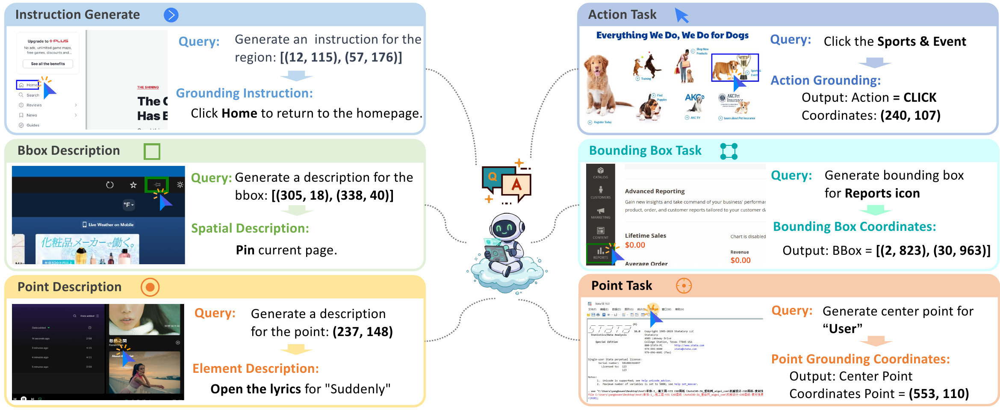
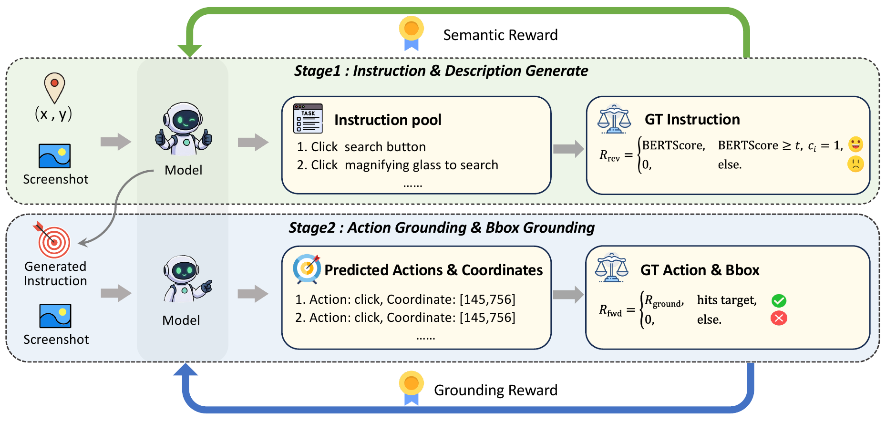

<div align="center">

<h1>BiGrounder</h1>
<h3>Bidirectional Training Unlocks the Potential of GUI Grounding</h3>

<p>On-policy instruction generation and cycle-consistent reinforcement for GUI grounding.</p>

<p align="center">
  &nbsp;&nbsp;📑 <a href="https://arxiv.org/abs/2611.07765">Paper</a>&nbsp;&nbsp; | &nbsp;&nbsp;🤗 <a href="https://huggingface.co/datasets/SnowRainsdy/ScaleCUA_Bbox_Rewrite">Dataset</a>&nbsp;&nbsp; | &nbsp;&nbsp;🤖 <a href="https://huggingface.co/SnowRainsdy/BiGrounder-4B">Model</a>&nbsp;&nbsp;
</p>

<p>
  <a href="#overview">Overview</a> &nbsp; | &nbsp;
  <a href="#data-construction">Data Construction</a> &nbsp; | &nbsp;
  <a href="#usage">Training &amp; Evaluation</a> &nbsp; | &nbsp;
  <a href="#repository-structure">Repository</a>
</p>

</div>

## Overview

**BiGrounder** addresses the many-to-one mapping between user instructions and GUI elements through bidirectional training. Given a screenshot and target coordinates, the model generates instruction variants on-policy, grounds them back to the target, and jointly improves generation and localization through cycle-consistent reinforcement learning.

<p align="center">
  
</p>

<p align="center"><sub>Six complementary tasks for bidirectional SFT (Figure 2 in the paper).</sub></p>

- **On-policy instruction exploration.** The current policy generates diverse expressions of the same target as training progresses.
- **Coupled bidirectional reinforcement.** Semantic verification and grounding success connect instruction generation with localization.
- **Standard grounding at inference.** Training reuses existing annotations and adds no reverse-generation steps at inference time.

<p align="center">
  
</p>

<p align="center"><sub>On-policy bidirectional reinforcement learning couples instruction generation with forward grounding.</sub></p>

## Data Construction

BiGrounder pairs each grounding task with its reverse instruction- or description-generation task. The same screenshot and target annotation support both directions, giving six complementary task formats:

| Task family | Forward grounding | Reverse generation |
| :--- | :--- | :--- |
| Action | Instruction to action and coordinates | Target coordinates to instruction |
| Bounding box | Description to bounding box | Bounding box to region description |
| Point | Description to target point | Target point to element description |

The Bi-SFT corpus contains 4.482M samples, split equally into 2.241M forward and 2.241M reverse samples. It combines ScaleCUA with the Video-Audio Production subset of GroundCUA and its reverse counterparts. An optional Gemini-2.5-Flash refinement step rewrites bounding-box descriptions into action-oriented instructions.

See [data_construction](data_construction/readme.md) for an action-grounding conversion example.

For instruction-variation evaluation, [OSWorld-G-R-Variants](OSWorld-G-R-Variants/OSWorld-G-R-Variants.json) contains 1,692 rewritten instructions for 564 targets. Pairing each original instruction with its three variants gives 2,256 grounding queries.

## Usage

Edit the model, data, and output paths in the launch scripts. Run commands from the repository root.

### Training

Each backbone has separate Bi-SFT and Bi-RL launchers:

| Backbone | Bi-SFT | Bi-RL |
| :--- | :---: | :---: |
| Qwen2.5-VL-3B | [Script](Bi_SFT/qwen2_5_3B_muti_dual.sh) | [Script](Bi_RL/verl-agent-master/run_bigrounder_qwen2_5_3B.sh) |
| Qwen2.5-VL-7B | [Script](Bi_SFT/qwen2_5_7B_muti_dual.sh) | [Script](Bi_RL/verl-agent-master/run_bigrounder_qwen2_5_7B.sh) |
| Qwen3-VL-4B | [Script](Bi_SFT/qwen3_4B_muti_dual.sh) | [Script](Bi_RL/verl-agent-master/run_bigrounder_qwen3_4B.sh) |
| Qwen3.5-35B-A3B | [Script](Bi_SFT/qwen3_5_35B_A3B_muti_dual.sh) | [Script](Bi_RL/verl-agent-master/run_bigrounder_qwen3_5_35B_A3B.sh) |

For example, the Qwen3-VL-4B training commands are:

```bash
bash Bi_SFT/qwen3_4B_muti_dual.sh
bash Bi_RL/verl-agent-master/run_bigrounder_qwen3_4B.sh
```

### Evaluation

[Eval/run_eval.sh](Eval/run_eval.sh) lists the Python commands and parameters for **ScreenSpot-Pro**, **ScreenSpot-V2**, **MMBench-GUI**, **UI-Vision**, and **OSWorld-G / OSWorld-G-R-Variants**. Select the command for the benchmark you want to evaluate.

### Ablation settings

<details>
<summary><strong>Instruction source, rollout budgets, and reverse updates</strong></summary>

G is `GROUP_SIZE`, K is `FORWARD_ROLLOUTS`. These settings appear at the top of each Bi-RL script.

| Setting | G | K | `INSTRUCTION_SOURCE` | `UPDATE_REVERSE` | `MAX_STEPS` |
| :--- | ---: | ---: | :--- | :---: | ---: |
| BiGrounder | 4 | 4 | online | true | 5 |
| Forward-only 1x16 | 1 | 16 | original | false | 16 |
| Forward-only 1x20 | 1 | 20 | original | false | 20 |
| Online generation, forward updates only | 4 | 4 | online | false | 5 |
| Frozen generator / offline bank | 4 | 4 | offline | false | 4 |

- **Gate-only rewards:** `REVERSE_REWARD_MODE=binary`.
- **Disable the cycle reward gate:** `CYCLE_VERIFICATION=false`; semantic filtering remains active.
- **Disable reverse updates:** `UPDATE_REVERSE=false` excludes reverse trajectories and their KL loss from training. The shared model continues to change through grounding updates.
- **Offline instruction variants:** read from `offline_instructions` in each task.

</details>

## Repository structure

| Directory | Contents |
| :--- | :--- |
| [Bi_SFT](Bi_SFT/) | Bidirectional SFT scripts and the ms-swift framework |
| [Bi_RL](Bi_RL/) | Bidirectional RL scripts, environment, and reward implementation |
| [Eval](Eval/) | Benchmark evaluators and model wrappers |
| [data_construction](data_construction/) | Reverse grounding data construction |
| [OSWorld-G-R-Variants](OSWorld-G-R-Variants/) | Instruction-variant annotations and generation utilities |

## Acknowledgments

BiGrounder builds on **ms-swift** and **verl-agent**, and uses grounding data from ScaleCUA and GroundCUA. We greatly appreciate their outstanding work. Third-party frameworks retain their original copyright notices and licenses: [ms-swift](Bi_SFT/ms-swift-4.0.0/LICENSE) and [verl-agent](Bi_RL/verl-agent-master/LICENSE).
